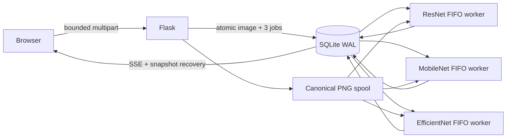

# Architecture and API

## Components

`main.py` delegates to `app/runtime/supervisor.py`, which holds the instance lock and supervises a Waitress web process plus three spawned model workers. Each worker loads one checkpoint, validates its outputs, renews a lane lease, and performs one forward pass at a time.

| Package | Responsibility |
| --- | --- |
| `app/api/` | Small route modules sharing ownership and service helpers |
| `app/runtime/` | Supervision, process entry points, instance locking, child process guard |
| `app/inference/` | Strict checkpoint loading and recorded preprocessing |
| `app/queue/` | Independent FIFO lanes, leases, recovery, and worker execution |
| `app/connection/` | Portable executable discovery and expiring tunnel state |
| `app/services/` | Admission, cleanup, research access, and snapshot assembly |
| `app/storage/` | SQLite connections, SQL schema, events, and job transitions |

`app/__init__.py` creates the application and installs `security.py`, `errors.py`, and the API blueprints. SQLite WAL uses a busy timeout, foreign keys, and short explicit write transactions. Image transforms and inference run outside those transactions.

## Connected frontend

Flask renders `app/templates/fruispect.html` with configured input limits and retention. `/static/fruispect/<filename>` serves the maintained `frontend/assets/` tree safely. Modules and API calls share the Flask origin and its restrictive content security policy.

`frontend/assets/app.js` manages navigation and pairing. `workspace/index.js` and `operator/index.js` assemble focused controllers with explicit state and action dependencies. View modules render snapshots; `state/requests.js` reconciles versioned results. `api/live.js` speaks the current API, and `api/watch.js` combines SSE replay with polling recovery. Styles are divided by feature under `css/` and loaded in a fixed cascade order.

Research views use original CSV model names and figure catalog paths. Operator request inspection covers this browser's collections. See [frontend source map](../frontend/README.md) and [configuration](CONFIGURATION.md).

Your Collections retains session ownership. Global Collections mounts only on the direct localhost host and uses independent gallery state with the same rendering, filters, result dialogs, commands, and event replay. Its discovery loop refreshes all retained collection summaries every five seconds while visible, including work from disconnected devices. The two views reference the same scans and share retention and deletion behavior.

Each admitted HTTP upload atomically saves an `upload_sources` row alongside its image and jobs. A keyed hash of the browser session supplies a stable, non-authenticating device ID without disclosing the session credential. Available model, inferred manufacturer, platform, browser, bounded user agent, connection type, and direct peer address are recorded at admission; idempotent retries preserve the original record. [User-Agent Client Hints](https://developer.chrome.com/docs/privacy-security/user-agent-client-hints) request optional model/platform details; unsupported or withheld fields remain unknown. MAC addresses are inaccessible to this web application. Tunnel uploads record no phone IP because the peer is the proxy, and forwarded client claims are not trusted. Reports cannot verify physical devices or people. Source metadata is returned only by host-scoped image and export routes and cascades away with the image. Existing scans have no retroactively inferred source.

## Optional phone access

The supervisor discovers a local ngrok executable, launches a hidden child process without a shell, and consumes its structured JSON endpoint logs. The real HTTPS origin is published to `service_state` with a short renewable expiry. This startup is independent of worker queues. Missing/failed/unconfigured ngrok leaves localhost operating; no tunnel is downloaded or account configuration changed. The supervisor stops only its own tunnel process.

Waitress trusts `X-Forwarded-Proto` only from the loopback upstream proxy, preserving the actual public Host. The application accepts the exact current tunnel host with HTTPS and a loopback peer; arbitrary hosts/forwarded hosts and HTTPS localhost rewrites are rejected. Public visitors can load the shell, static files, connection state, and pairing endpoint. All other public APIs require a session grant bound to the current tunnel generation. The desktop alone sees the pairing code and fragment-based automatic connection link. Public pairing failures are bounded to ten/minute; codes rotate at launch and cookies are Secure for HTTPS requests. Local session behavior remains unchanged. ngrok's request inspection is disabled; phone traffic still transits the ngrok service.

`GET /api/connection` returns connection status and whether pairing is needed; only direct loopback HTTP can receive the pairing code/link. `POST /api/connect` accepts JSON `{code}` with normal same-origin/CSRF checks and establishes the session grant. No API access token or ngrok authtoken is returned publicly. See the [ngrok CLI](https://ngrok.com/docs/gateway/agent/cli) and [Waitress proxy settings](https://docs.pylonsproject.org/projects/waitress/en/stable/arguments.html).

## Queue guarantees

After decoding validation, admission atomically reserves bounded storage, allocates the immutable global image sequence, and inserts all three `WAITING_FOR_INPUT` jobs. Canonical preprocessing happens outside the transaction. Workers cannot overtake an earlier accepted input still being prepared. Preprocessing failure after acceptance remains an accepted image with explicit terminal failures. Interrupted ingestion is reconciled on supervisor restart; the operator can rescan.

A worker queries only its own oldest nonterminal head. A waiting/running/backoff head blocks only that lane. Results and versioned events commit together. Cross-model results are never a dependency for claiming the next job. `image.complete` aggregates display state after all jobs become terminal; partial results are already visible.

Owner tokens fence lane leases and commits. Heartbeats renew a 30-second lease. A restarted worker waits out the previous lease and recovers its unfinished head before starting newer work. Budget: three attempts; retries wait 2/4 seconds at the head. A stale owner or duplicate completion cannot overwrite results. Crash recovery may recompute a forward pass whose commit was lost; terminal results/events remain unique.

| Current | Allowed next |
| --- | --- |
| WAITING_FOR_INPUT | QUEUED, FAILED, CANCELLED, UNAVAILABLE |
| QUEUED | RUNNING, FAILED, CANCELLED, UNAVAILABLE |
| RUNNING | COMPLETED, FAILED, CANCELLED, QUEUED (retry/recovery) |
| Any terminal state | None |

Central transitions increment job versions and check the prior version transactionally. Running cancellation sets a versioned flag: the forward finishes and discards its result. Committed results remain. A missing model terminally marks its own lane jobs unavailable; repaired weights require intentional rescans of those terminal jobs.

Idempotency uses `(batch_id, request_key, file_index)` and content SHA-256. Repeats return original IDs; reused accepted keys with changed content return 409. Rejected files can retry. Intentional rescans use new keys. All admission/fan-out and state changes are durable before events are exposed.

## API

Errors: `{"error":{"code":"...","message":"..."}}`. Per-file errors appear in the ingestion rejection list. POST requires `X-Fruispect: 1`, same-origin checks, and session ownership. Public result timestamps use ISO UTC. Queue telemetry can contain explicitly named Unix timestamps.

| Method/path | Purpose |
| --- | --- |
| GET `/api/health` | Liveness |
| GET `/api/readiness` | Storage + all workers; 503 until ready |
| GET `/api/models`, `/api/queues` | Lane registry, health, active/upcoming jobs, rolling stats |
| POST `/api/batches` | 202 `{batch}`; optional Idempotency-Key |
| GET `/api/batches` | All retained session batches, newest first |
| POST `/api/batches/:id/images` | Multipart `images`, 1–4/chunk; required key; optional offset |
| GET `/api/batches/:id` | Summary + cursor |
| GET `/api/batches/:id/images` | Page/limit/total; default 20, max 50 |
| GET `/api/images/:id` | Three independent versioned states/results |
| GET `/api/images/:id/thumbnail` | Metadata-stripped JPEG |
| GET `/api/events?batch_id=:id&after=0` | SSE replay + Last-Event-ID + heartbeats |
| GET `/api/batches/:id/events?after=0` | Poll replay, 200 events/page + next cursor |
| POST `/api/batches/:id/cancel` | Cancel queued work, flag in-flight work |
| POST `/api/images/:id/cancel` | Cancel image |
| GET `/api/settings` | Browser storage totals; global totals only on localhost |
| POST `/api/batches/:id/delete` | Delete one owned collection and its activity/files |
| POST `/api/settings/collections/delete` | Delete this browser's collections |
| POST `/api/settings/reset` | Localhost only; JSON `{"confirmation":"RESET"}` clears all scan data |
| POST `/api/connection/retry` | Localhost request to restart the owned ngrok process |
| GET `/api/evaluation/summary` | Original research tables + provenance |
| GET `/api/evaluation/figures` | Verified catalog; missing paths null |
| GET `/api/evaluation/artifact/figures/:file` | Controlled PNG/PDF access |
| GET `/api/export/:batch_id?format=csv` | Streaming CSV/JSON observations |
| GET `/api/global/batches` | Localhost only; all retained collections across devices |
| GET `/api/global/batches/:id`, `/api/global/batches/:id/images` | Global collection summary and the same filtered/paginated image snapshots |
| GET `/api/global/images/:id`, `/api/global/images/:id/thumbnail` | Global image results, source attribution, and protected thumbnail |
| GET `/api/global/events`, `/api/global/batches/:id/events` | Global collection SSE/polling replay with the same cursors and limits |
| GET `/api/global/export/:id?format=csv` | Global CSV/JSON observations with `upload_` source columns |
| POST `/api/global/batches/:id/cancel`, `/api/global/images/:id/cancel` | Host cancellation of unfinished checks across devices |
| POST `/api/global/batches/:id/delete` | Delete one global collection and its owner's scan data |

Image query filters: search, status, fruit, quality, agreement=agreement/disagreement, sort=oldest/newest (default newest). View sorting never changes FIFO. Fruit/quality filters match any successful model. TERMINAL means every corresponding job is terminal. Three-model agreement requires all three successes.

Every `/api/global/` request is rejected before data access unless both the HTTP hostname and peer identify direct localhost access. Pairing a tunnel device, enabling LAN access, or supplying forwarded headers does not grant global access. Personal endpoints continue enforcing session ownership even for the host. Global bulk deletion uses the existing localhost-only reset endpoint and requires the UI confirmation text `RESET`.

Ingestion returns `{accepted:[{file_index,image_id,admission_seq,duplicate}],rejected:[{file_index,filename,code,message,http_status}]}`. Partial acceptance returns 202. Full rejection uses the applicable 4xx/503. Capacity backpressure is 429/503 and `Retry-After: 2`. Browser submits one file/request with stable keys; byte/pixel/batch/queue/spool/upload-slot limits bound resource use.

## Events and browser recovery

Every event includes event_id, batch_id, image_id/model_key where relevant, monotonic job version, type, time, payload. Types: image.accepted, image.preprocessed, model.queued/started/completed/failed/unavailable/cancelled/cancellation_requested, image.complete, batch.progress/cancelled. Queue snapshots are independent `/api/queues` polling. SSE triggers immediate individual image snapshot reads. Periodic snapshots repair gaps, with polling fallback. Streams last at most five minutes before reconnect and are capped at eight concurrent listeners.

Frontend maps by immutable batch/image/model IDs, rejects duplicate/stale versions, and keeps a 20-row page plus selection. Accepted uploads explicitly select their new image; late inference events preserve the selected image. Deleted collections close existing SSE streams with a `removed` event; polling also clears views on 404. Confidence bars show actual head scores. No fake CNN progress percentage or ETA is generated. Parallel HTTP reads only retrieve snapshots; they do not wait for model completion.

## Lifecycle and security

Cleanup removes whole expired batches only after all jobs become terminal, then unlinks controlled spool paths. Metadata/events/results share retention. Active jobs retain their input beyond expiry. Raw-upload headroom reserves `MAX_FILE_MB ? UPLOAD_SLOTS` inside the spool budget before derivative admission. Old unreferenced spool files are swept after one hour, or immediately during locked startup before uploads can begin. Original research files are never cleaned.

Explicit deletion acquires every upload slot (409 if intake is active), then atomically removes batches with cascading jobs/events/submissions. Late worker completions find no job and are discarded. File paths are queued in `file_deletions`, restricted to the spool, and retried by the supervisor if Windows still has an input open. Reset also removes unreferenced spool files while preserving the running model registry and service/connection configuration.

Local binding, host/origin checks, session ownership, optional LAN Basic token with HTTPS/access controls, generated spool names, decode validation, no unsafe checkpoint fallback, CSV formula escaping, and restrictive response headers define the local trust boundary. This is a single-host application; multi-host scheduling and public Internet service operation are outside its scope.
