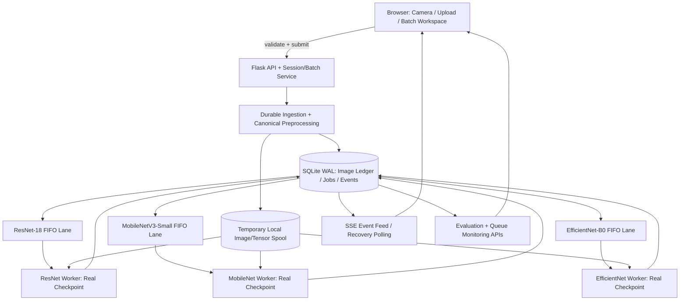

# FRUISPECT — Complete Web Application Implementation Prompt

> **Role:** Act as a senior full-stack engineer, computer-vision deployment engineer, systems architect, UX designer, and test engineer. **Implement** a complete, locally runnable Fruispect web application inside the existing repository, integrating the already-trained checkpoints rather than retraining or replacing them. Inspect all existing project files first; treat the repository's actual inference code, checkpoint structures, and preprocessing metadata as the executable source of truth. Deliver production-minded, research-faithful software, not a static UI mockup or a demonstration with fabricated predictions.

## 0. Project identity and non-negotiable constraints

**Name:** Fruispect — *See the Fruit. Know its Quality.*  
**Research context:** CCS 250 Computer Vision, comparative evaluation of ResNet-18, MobileNetV3-Small, and EfficientNet-B0 for multi-task fruit recognition and visual quality classification.  
**Primary user experience:** Upload one or many photographs, or capture a photograph through a browser camera, and see independent results from all three neural networks as soon as each becomes available.  
**Core differentiator:** **Three genuinely independent, first-in-first-out (FIFO) inference queues**, one per model, with no cross-model waiting barrier.

### Research contract

- All three networks were **trained from scratch** (not initialized with ImageNet/pretrained external weights). **Do not retrain, fine-tune, replace, download, or simulate the saved models.**
- Models: **ResNet-18**, **MobileNetV3-Small**, and **EfficientNet-B0**.
- Each model has a **shared CNN backbone with two parallel classification heads**: fruit logits of shape `[N, 6]` and quality logits of shape `[N, 2]`.
- Fruit label mapping, in exact order: `0 Apple`, `1 Banana`, `2 Guava`, `3 Lime`, `4 Orange`, `5 Pomegranate`.
- Quality label mapping, in exact order: `0 Good`, `1 Bad`.
- The quality head is **not** a second model that takes the hard fruit prediction as input; it receives the same backbone features as the fruit head.
- Each accepted image must be offered to **all three models**, and every model must use equivalent deterministic evaluation preprocessing matching actual training artifacts.
- The application assumes **one primary fruit per image**, not multi-object detection or independent classification of multiple fruits in one image.
- Good/Bad describes **visible appearance**, not food safety, internal freshness, or contamination. Unsupported fruits and arbitrary objects are not trained as a reliable seventh class; do not claim robust out-of-distribution recognition.
- Evaluation metrics from the saved research outputs must remain separate from predictions on new user images. A new photograph without a ground-truth label cannot be used to claim accuracy.

## 1. First step — audit and integrate existing assets

Inspect the repository before creating files. The supplied project structure includes the following existing artifacts:

```text
Fruispect-CV/
├── trained-outputs/
│   ├── figures/
│   ├── models/
│   │   ├── efficientnet_b0.pth
│   │   ├── mobilenet_v3_small.pth
│   │   └── resnet18.pth
│   ├── runs/
│   ├── tables/
│   ├── experiment_manifest.json
│   ├── figure_catalog.json
│   ├── fruispect_inference.py
│   ├── preprocessing.json
│   ├── split_manifest.csv
│   └── versions.json
├── .gitattributes
└── README.md
```

The paths above are user-supplied; **verify they exist locally**, their actual contents, and their compatibility. If a file is absent, report it precisely and support graceful degradation—never invent its contents or quietly select default values that might change predictions. Preserve original research artifacts and checkpoint files unchanged.

**Required audit:**

1. Inspect `fruispect_inference.py` for existing model definitions, constructors, loading utilities, input transforms, output tensor order, and inference conventions. Prefer to reuse or safely refactor its legitimate functionality rather than independently guessing head definitions.
2. Inspect checkpoint dictionary keys and tensor shapes for each `.pth`; determine whether each contains a direct `state_dict`, a `model_state_dict`, or another known supported wrapper. Implement an explicit, testable adapter for the **observed** format only.
3. Read `preprocessing.json` for resizing, aspect-ratio preservation/padding, interpolation, channel format, normalization mean and standard deviation, and expected image dimensions. Follow its actual values even where the proposal only states preliminary intentions (224 × 224 RGB input, aspect-ratio-preserving resize/pad, training-derived normalization).
4. Read `experiment_manifest.json`, `versions.json`, `runs/`, `tables/`, and `figure_catalog.json` to discover actual checkpoint provenance, library versions, metrics, benchmark conditions, plots, and reproducibility metadata. Distinguish measured facts from empty/missing fields.
5. Verify model construction loads all keys strictly, with no unexpected or missing parameters. **Never use `strict=False` as a shortcut to make an incompatible checkpoint appear to load.**
6. After loading, run a deterministic smoke test with a correctly shaped tensor and verify finite, valid fruit and quality logits of shapes `[1,6]` and `[1,2]`, on CPU at minimum.
7. Record checkpoint SHA-256, preprocessing configuration hash, chosen device, model name, framework versions, and readiness on startup. Associate results with the corresponding checkpoint version.
8. Compare the new inference path against the original reference inference helper on the same test images/tensors, checking logits and probabilities within suitable floating-point tolerances.
9. Do not evaluate user images with training-time random augmentation. Do not silently substitute ImageNet normalization or `weights='DEFAULT'` unless these exact settings are proven by project artifacts (the trained-from-scratch models should not load external pretrained weights).
10. Use `torch.load(..., map_location='cpu', weights_only=True)` when compatible with the actual checkpoint, instantiate the **exact** architecture and dual-head definitions, load weights, move to configured device, call `eval()`, and run under `torch.inference_mode()`. **Do not deserialize untrusted full Python objects or enable unsafe pickle loading.** If legacy checkpoints are incompatible, diagnose the issue instead of silently weakening security.

**Hard gate:** Do not implement a fake fallback classifier, randomized confidence generation, placeholders posing as predictions, or a frontend-only demo. Clearly mark a model as unavailable if its actual weights cannot be loaded.

## 2. Technical architecture and technology choices

Keep the research proposal's stack unless existing code provides a compelling compatibility reason to do otherwise:

- **Backend:** Python 3, Flask using an application factory, modular Blueprints/REST endpoints, a separate durable queue coordinator, and dedicated worker processes.
- **Inference:** PyTorch, TorchVision, existing model definitions, NumPy, Pillow and/or OpenCV. Use versions compatible with the training artifacts; document and pin tested dependencies.
- **Persistence:** Local **SQLite in WAL mode** for durable metadata, ordering, jobs, statuses, results, and incremental events; local application-controlled spool directory for temporary validated image and canonical preprocessing files. Use a short, configurable retention window and cleanup.
- **Frontend:** HTML5, CSS, and modular JavaScript or TypeScript; a lightweight component/build system is optional but must build to a local, self-contained offline bundle. Avoid unnecessary frontend framework complexity. No CDN requirement for basic functionality.
- **Live communication:** Server-Sent Events (SSE) for server-to-browser one-way progress/results, with cursor-based event replay and polling fallback; regular REST endpoints for submissions, commands, and recovery. Use authenticated or local-only sessions as appropriate.
- **Deployment:** A single host running the Flask server plus **three separately supervised inference worker processes**, one for each model. Do not depend on Flask request threads or a development-server reloader to run durable jobs.
- **Scheduling:** Start with a concurrency setting of **one active inference per model queue**. Each model may progress independently. Support CPU-only execution and optional CUDA if available and capacity-tested.
- **Operation:** Offline-first on `localhost`, optional LAN hosting with appropriate camera-origin security, network access controls, and HTTPS where necessary. No paid inference API, remote inference dependency, cloud database, or external authentication requirement for local use.

### Logical architecture



The graph is **fan-out on admission, independent execution, merge only for visual comparison**. There must be **no join or barrier** on image completion across models and no global call resembling `await Promise.all(allThreeModels)` before exposing a model's completed result.

## 3. Critical requirement — independent strict-FIFO queue semantics

**This is the highest-priority functional requirement.** Implement queue independence in the backend, not just with frontend animations.

### 3.1 Queue topology

Create three separately addressable durable lanes:

```text
Queue R: resnet18           -> dedicated ResNet-18 process
Queue M: mobilenet_v3_small -> dedicated MobileNetV3-Small process
Queue E: efficientnet_b0    -> dedicated EfficientNet-B0 process
```

On acceptance of images `I001`, `I002`, `I003` in that order, create these per-model jobs atomically:

```text
R: [I001, I002, I003, ...]
M: [I001, I002, I003, ...]
E: [I001, I002, I003, ...]
```

Each queue follows **the same monotonic image admission sequence**, but **each model's progression is completely independent**. Workers dequeue their own oldest eligible, nonterminal head item only. Do not use a shared index, common semaphore that requires all three results for an image, global batch barrier, or per-image synchronization dependency between model workers.

### 3.2 Exact expected behavior

Suppose ResNet completes `I001` in 300 ms; MobileNet is still computing `I001`; EfficientNet is still computing `I001`:

- Immediately persist the ResNet result for `I001`.
- Immediately notify the browser and render **only ResNet's completed cell** in `I001`'s comparison row; MobileNet/EfficientNet still show their real states.
- **ResNet must immediately claim and begin `I002`**, even if the other two are still processing `I001`.
- MobileNet and EfficientNet independently start `I002` only after **their own** `I001` jobs end or reach a terminal failure/cancellation state.
- A later event for `I001` must update the correct `image_id`/`model_key` cell even if the operator is currently viewing `I010` or another page. Never let a late result overwrite the currently selected image's results.
- Each model lane preserves the order of starts and terminal completions. **Cross-model completion order may differ freely.**

### 3.3 FIFO and atomic admission details

- Assign an immutable, globally increasing `admission_seq` at server acceptance, not from client timestamps or upload filenames. All three jobs for one image share this sequence and differ by `model_key`.
- Atomically create one image record and the three per-model jobs in one database transaction. Prevent orphaned jobs, missing model fan-out, and partial record insertion.
- If canonical preprocessing is asynchronous, create reserved entries **in admission order** and track input readiness. A later preprocessed image may not leapfrog an earlier accepted image within a model lane. Workers wait for the earliest nonterminal item to become ready, fail, or be cancelled. This maintains strict FIFO even when input processing finishes out of order.
- Define **one in-flight inference per model lane** by default. Never launch unbounded threads/processes that change per-lane completion order. If optional microbatching is added, preserve FIFO accounting and avoid making it the default interactive path.
- Each lane has its own `QUEUED`, `WAITING_FOR_INPUT`, `RUNNING`, `COMPLETED`, `FAILED`, `CANCELLED`, and `UNAVAILABLE` outcomes, with intermediate states distinct from terminal states. Specify valid transitions and enforce them centrally.
- A recoverable failed job can retry with bounded attempts and backoff. Under **strict FIFO**, keep a retrying head ahead of newer jobs; after exhausting its attempt budget, mark it terminally `FAILED` and advance the lane. Errors in one lane must not block other lanes.
- Worker claims and status updates must be transactional. Use leases/heartbeats or equivalent crash recovery; on restart, reconcile stale `RUNNING` jobs before claiming newer entries, without dropping or skipping earlier work.
- Results and event generation must be idempotent. Duplicate submissions carrying the same request idempotency key or duplicate events must not create duplicate jobs/results. Distinguish intentional repeat scans from accidental network retries.
- Each worker loads its model checkpoint **once on startup**, keeps it warm, processes its own queue until shutdown, and frees tensors after each inference. Never reload a `.pth` on every image.
- Expose each lane's status independently: ready/unavailable, active image, queue depth, completed/failed counts, current job duration, per-model estimated wait if statistically supported, and last error.

### 3.4 Bounded throughput, memory, and storage

- Support a submitted batch of **at least 100 images** through streaming/chunked ingestion, bounded in-flight processing, and durable spool files, subject to configurable local disk limits. Design tests for 10, 50, 100, and optionally 300 images; do not promise an arbitrary throughput rate independent of hardware.
- Introduce configurable limits for each file size, image pixel count, batch size, queued jobs per model, maximum total spool bytes, number of concurrent uploads, and retention period. Set sensible initial limits but keep them tunable and measured.
- Decode and validate images safely; prevent decompression bombs and path traversal. Avoid holding a full 100-image batch in RAM. Never place base64 blobs or image binaries inside SQLite rows or SSE events.
- Admit images in manageable chunks, with clear acceptance/rejection reports. If a queue or disk is saturated, return structured backpressure (`429`/`503`, optionally `Retry-After`) and allow retry of **unaccepted** images; never silently discard accepted jobs.
- A batch may have partially accepted files due to validation/capacity constraints; return exact accepted/rejected file indexes and reasons. Preserve image order for accepted items.
- Keep the UI interactive even during heavy inference. Limit thumbnail rendering with virtualization/pagination and release browser object URLs no longer needed.
- Do not assume three GPU processes have three independent GPUs. If sharing one GPU, capacity-test VRAM and contention, use per-worker memory controls or a device-level resource gate if required, and clearly report real scheduling delays. **A hardware resource constraint may slow a lane, but no lane may wait for another model to produce a matching image result.** If VRAM cannot safely fit three workers, provide a documented supported CPU fallback or an alternative single-device executor with per-model FIFO and asynchronous job completion—not a disguised cross-model barrier.
- Support graceful shutdown: stop accepting new work, finish or safely checkpoint current jobs, then resume unfinished jobs after restart.

### 3.5 Acceptance scenario: must pass

Given 3 accepted images in order, the ResNet worker's `I001` inference finishes while MobileNet's `I001` is still running. Observe:

1. ResNet result for `I001` appears immediately.
2. ResNet `I002` changes to `RUNNING` **before** MobileNet `I001` completes.
3. MobileNet's independent FIFO remains `I001 → I002 → I003`.
4. No duplicate result, lost job, incorrect row update, or blocked global pipeline occurs.
5. `I001` transitions to fully processed only after all three model jobs are terminal; its **partial results were visible earlier**.

Test with controllable synthetic delays in the **test harness only**, while production still uses actual checkpoints.

## 4. Image ingestion and preprocessing contract

### 4.1 Input channels

1. **Single image upload:** Drag-and-drop, file chooser, paste an image where supported, preview, confirm, clear, and rescan.
2. **Batch upload:** Multi-select 10–100+ images, drag multiple images/folders if the browser supports it, show per-file validation, maintain original order, submit accepted files incrementally, and continue viewing results during later uploads.
3. **Browser camera:** Use `navigator.mediaDevices.getUserMedia` with explicit permission, camera selection, camera start/stop, switch if available, still-image capture, retake, and camera unavailable/permission-denied states. Require a secure context (`localhost` or HTTPS); do not claim camera access will work over unencrypted remote LAN HTTP.
4. **Optional continuous scanning:** This is secondary to still capture. Sample frames at a configurable limited frequency; **never enqueue every video frame indiscriminately**. Provide separate live-sampling policy (skip samples before acceptance when backlog is high, with visible skipped-frame count); preserve FIFO for every **accepted** frame. Never silently drop accepted batch-upload jobs.

### 4.2 Input validation

- Accept verified JPEG, PNG, and optionally WebP if the imaging library and project support it. Validate actual file signatures/decoding rather than trusting extensions or browser MIME types.
- Check byte size and decoded dimensions; cap megapixels to limit CPU/memory exhaustion. Handle corrupt/truncated images, zero-byte files, unsupported formats, animated images (explicit first-frame or reject policy), oversized files, and read errors.
- Correct EXIF orientation, convert color reliably to RGB, handle alpha transparencies with a documented background policy, and discard irrelevant metadata when storing derivatives.
- Do not auto-crop so aggressively that signs of visible deterioration disappear. Honor exact resize-and-pad, interpolation, input range, and normalization from `preprocessing.json`.
- Implement one shared deterministic canonical transform for all models. Prefer immutable cached canonical preprocessed input on disk or a bounded shared cache; all workers must consume logically identical pixels/tensors. Store a preprocessing hash to diagnose mismatches.
- Distinguish validation/preprocessing time from actual CNN forward-pass latency. Return a useful error for a failed individual image without poisoning the entire batch.
- Avoid treating duplicate content as new accidental uploads if the same idempotent request is retried. Permit users to intentionally rescan the same photograph under a **new** scan ID.

### 4.3 Model outputs

For each model and image, produce exactly:

- `predicted_fruit`, `fruit_class_index`, `fruit_confidence`, and optional six-class probability vector.
- `predicted_quality`, `quality_class_index`, `quality_confidence`, and optional Good/Bad probability vector.
- `model_key`, human-readable architecture name, checkpoint hash/version, and device.
- `inference_ms` (time for real forward execution, excluding waiting/preprocessing; synchronize CUDA for accurate elapsed GPU measurements), `queue_wait_ms`, `preprocess_ms` where meaningful, and `end_to_end_ms` once complete.
- `started_at`, `completed_at`, job status, and any failure code.

Use **separate softmax operations** on fruit and quality logits. Confidence is a model score, **not guaranteed correctness or calibrated probability**. Do not combine the two heads into a fabricated 12-class softmax or imply the quality result is conditional on the hard fruit label.

## 5. Durable domain model and public APIs

### 5.1 Persistence schema

At minimum, design normalized, indexed tables equivalent to:

```text
batches(batch_id, session_id, created_at, status, total_submitted,
        total_accepted, total_rejected, completed_images, cancelled_at)
images(image_id, batch_id, admission_seq, display_index, original_filename,
       content_sha256, image_path, canonical_input_path, input_status,
       received_at, preprocessed_at, retention_expires_at)
model_jobs(job_id, image_id, model_key, admission_seq, status, attempt_count,
           queued_at, lease_owner, lease_expires_at, started_at, completed_at,
           queue_wait_ms, inference_ms, error_code, error_message,
           model_checkpoint_sha256, result_json,
           UNIQUE(image_id, model_key))
model_registry(model_key, display_name, checkpoint_path, checkpoint_sha256,
               device, state, validated_at, last_error)
events(event_id, batch_id, image_id, model_key, event_type, version,
       created_at, payload_json)
```

Include useful indexes for `(model_key, admission_seq, status)`, `(batch_id, display_index)`, and ordered event replay. Avoid data races: SQLite WAL supports concurrent readers but still serializes writers; keep transactions short, set busy timeouts, and never perform neural-network inference while holding a database transaction.

### 5.2 Recommended REST contract

Use consistent JSON response envelopes with stable IDs, ISO 8601 timestamps, error codes, pagination, and documented API schemas. Design endpoints equivalent to:

```text
GET    /api/health                    liveness
GET    /api/readiness                 validated model + storage + worker readiness
GET    /api/models                    model identities, versions, devices, status
POST   /api/batches                   create a new batch/session
POST   /api/batches/:id/images        add one or multiple files, chunkable
GET    /api/batches/:id               batch summary and progress
GET    /api/batches/:id/images        paginated image list with three job states
GET    /api/images/:id                one image + three independent results
GET    /api/queues                    three lane statistics and current work
GET    /api/events?batch_id=...       SSE feed with IDs/replay
GET    /api/batches/:id/events        polling or cursor fallback
POST   /api/batches/:id/cancel        cancel queued jobs and flag in-flight policy
POST   /api/images/:id/cancel         cancel that image's nonterminal work
GET    /api/evaluation/summary        verified saved research metrics
GET    /api/evaluation/figures        verified figure catalog / paths
GET    /api/export/:batch_id          downloadable CSV/JSON results
```

Prefer idempotency keys for submission endpoints. For creation, return `202 Accepted` with accepted IDs and an accurate rejection list. Make cancellation behavior explicit: queued jobs can be cancelled immediately; a running torch forward pass usually cannot be preempted safely, so mark cancellation requested and discard/transition its late result per documented rules. Do not purge image input until all corresponding jobs are terminal and their relevant events have been recorded.

### 5.3 SSE and frontend reconciliation

- Emit typed events: `image.accepted`, `image.preprocessed`, `model.started`, `model.completed`, `model.failed`, `model.unavailable`, `image.complete`, `batch.progress`, `batch.cancelled`, `queue.snapshot`.
- Every event includes immutable `event_id`, `image_id`, `model_key` where relevant, per-job monotonic `version`, and authoritative status. On reload/reconnect, replay events after the stored cursor or fetch a fresh batch snapshot.
- The frontend reduces incoming events into a normalized state indexed by **`batch_id` / `image_id` / `model_key`**, never by the currently selected card or result arrival order. Ignore stale versions and duplicates.
- Maintain server truth when reconnecting. A disconnected browser does not stop backend jobs, and reopening a session within its retention window restores completed and pending states.
- Support heartbeats, clean disconnects, concurrency limits for event listeners, and polling fallback when EventSource/SSE is unavailable.

## 6. Product features, views, and interaction design

Create a distinctive, polished, minimal, futuristic **computer-vision research application**, not a generic CRUD dashboard. Use deliberate hierarchy, restrained colors, crisp typography, high contrast, purposeful microinteractions, and accessible motion. The interface should feel technically credible and presentation-ready for a classroom demonstration while being usable for real batches.

### A. Main workspace / Scan

- Header: Fruispect identity and tagline, compact system status indicator, device mode (`CPU`/`CUDA`), and navigation to Workspace, Queue Monitor, and Model Evaluation.
- Primary intake zone: camera preview/capture and drag-drop/browse/upload. A segmented mode switch for **Camera / Upload / Batch** is appropriate.
- Show selected image preview, file details, accepted count, validation failures, and clear actions (`Capture`, `Retake`, `Add Images`, `Start Batch`, `Cancel Queued`).
- Explain scope subtly: **single principal fruit per image**, **visual quality only**.
- On accepted images, immediately render a comparison layout with three equal model panels; do not wait for all three predictions.

### B. Per-image three-model comparison

Each model panel displays:

- The model's correct name, model-ready state, and independently updated queue/job status.
- Fruit prediction with class icon or simple illustration and confidence bar.
- Quality prediction `Good` / `Bad` with a second, separate confidence bar.
- Real measured inference duration, queue wait, optional six-class score details, and model/checkpoint info in an expanded view.
- Explicit states for waiting, running, completed, error, cancelled, and model unavailable. Skeleton/progress animation may be used, but **never fabricate percent complete for CNN forward passes**.
- Individual results appear at the instant they are received; other panels remain pending without disabling this result.

Comparison summary:

- After two or three results, optionally preview **partial agreement** as clearly provisional.
- Once all three are terminal, compute separate **fruit consensus**, **quality consensus**, and **disagreement** flags from available successful outputs. If a model failed, label consensus incomplete rather than claiming unanimity.
- Visually distinguish `fruit disagreement`, `quality disagreement`, and `both`.
- If probabilities are displayed, label them **model confidence** and show each task separately; no false correctness claim.

### C. Batch gallery and result grid

- Provide ordered image thumbnails/list rows keyed to submission order, with each model's own status and its fruit/quality result when ready.
- Users can select any image while work continues. New incoming results update the correct row without jumping selection, reordering the gallery, or overwriting the visible image.
- Include search, filters by fruit/quality/model agreement/status, sortable **view-only** columns, and expandable details. Sorting the UI must never change backend FIFO.
- Summary strip: accepted, preprocessing, queued, processing, fully complete, failed, cancelled, average per-model inference, and partial-vs-complete images.
- Use virtualization or pagination for hundreds of images. Include per-file errors and clear accepted-versus-rejected counts.
- Export observed predictions and timing to CSV/JSON; include model/checkpoint versions, timestamps, error statuses, and source image ID. Do not include unsupported “accuracy” calculations without ground truth.

### D. Queue monitor

Create a transparent visual representation of **three independent lanes**, e.g. horizontal conveyor/queue rows:

```text
RESNET-18         [RUNNING I009] → [I010] [I011] [I012] ...
MOBILENETV3-SMALL [RUNNING I006] → [I007] [I008] [I009] ...
EFFICIENTNET-B0   [RUNNING I008] → [I009] [I010] [I011] ...
```

This is only an **illustrative example**, not a forced ordering. Show each lane's current image, queue depth, throughput, mean/p95 inference time for a defined rolling window, failures, and health. Use subtle progress movement without presenting an invented precise percentage or runtime ETA. Ensure the visualization accurately reflects the backend state during asynchronous work.

### E. Research evaluation dashboard

Read and use only **real existing** output artifacts in `trained-outputs/tables`, `figures`, `runs`, and catalog/manifest JSON. Allow model-by-model comparison of any verified available values:

- Fruit accuracy, quality accuracy, joint accuracy.
- Fruit/quality macro precision, recall, and F1.
- Class-level and per-fruit quality evaluations, including confusion matrices.
- Checkpoint size, trainable parameter count, recorded training duration, measured inference mean/p95 latency and throughput (with device/benchmark provenance).
- Controlled photographic stress-test results for dimming/brightening, rotation, contrast variation, and diagnostic grayscale cases if actually present.
- Clear provenance tags: **Held-out Test**, **Controlled Stress Test**, and **Current Application Inference**. Never conflate these categories.
- Gracefully explain missing metrics/artifacts; do not draw fake charts or extrapolate results.

### F. Experience and accessibility

- Responsive desktop-first layout, practical tablet/mobile adjustments, keyboard-accessible controls, semantic labels, tooltips, high-contrast modes and reduced-motion support.
- Useful empty states, clear first-use instructions, visible errors, recoverable failures, and confirmation before destructive cancellation.
- Smooth but light transitions. Avoid animation that slows inference or becomes distracting during large batches.
- Use local/static visual assets; application must load without an Internet connection after installation.
- Do not ask the user to manually refresh the page to see results.

## 7. Functional requirements matrix

Implement and verify the following behaviors:

| ID | Required behavior |
|---|---|
| FR-01 | Browser camera preview, permissions, capture, retake, stop, and error recovery. |
| FR-02 | Validated single-image upload via browse, drag-drop, and optional paste. |
| FR-03 | Large multi-image batch upload with partial validation and bounded admission. |
| FR-04 | Exact verified deterministic preprocessing; identical logical inputs to all models. |
| FR-05 | Load the three actual `.pth` checkpoints once, correctly and securely. |
| FR-06 | Produce separate six-class fruit and Good/Bad quality predictions for each model. |
| FR-07 | Three persistent independent strict-FIFO lanes, with no per-image model synchronization barrier. |
| FR-08 | Show each independent model result immediately upon completion, including late/out-of-order cross-model updates. |
| FR-09 | Display measured inference, queue wait, and appropriate confidence information. |
| FR-10 | Display batch gallery, independent statuses, filters, details, and export. |
| FR-11 | Show genuine three-model disagreements and appropriately qualified consensus. |
| FR-12 | Show a real-time per-model queue health and throughput monitor. |
| FR-13 | Show actual recorded held-out evaluation and stress-test artifacts with provenance. |
| FR-14 | Support cancellation, idempotent retries, reconnection, reload, and worker restart. |
| FR-15 | Operate entirely offline locally after installing dependencies and trained models. |
| FR-16 | Clean up temporary images/results by documented retention policy, without deleting active jobs. |
| FR-17 | Distinguish real model unavailability from individual inference failures; let healthy lanes continue. |
| FR-18 | Support optional throttled camera sampling without overloading or violating accepted-job FIFO. |

## 8. Non-functional requirements and engineering targets

- **Correctness:** Predictions must come from actual saved weights and the real dual-head architectures. Unit, integration, and reference parity tests must verify label mapping, shapes, softmax computations, and deterministic preprocessing.
- **FIFO integrity:** Within each model queue, accepted image `admission_seq` is not overtaken. Across models, progress and completion must remain independent.
- **Responsiveness:** The browser must remain interactive while at least 100 accepted images are being processed; uploads, previews, scrolling, filters, and cancellation cannot depend on a blocking inference request.
- **Scalability:** Memory usage should be bounded as the number of accepted files increases; use streaming intake, spool storage, queue capacity and backpressure. Do not claim 100 parallel neural-network forwards.
- **Reliability:** Invalid files, decoding failure, failed worker, out-of-memory errors, missing model, browser disconnect, duplicate events, and application restarts must have explicit, recoverable behavior.
- **Reproducibility:** Record dataset/experiment manifest references, versions, preprocessing hash, checkpoint hash, timings, machine device, and relevant runtime configuration. Keep original training results unmodified.
- **Performance measurement:** Distinguish `preprocess_ms`, `queue_wait_ms`, `inference_ms`, and `end_to_end_ms`. For CUDA, synchronize before stopping compute timers. Report throughput as **model jobs/sec** separately from **fully processed images/sec**; do not simply add three model throughput figures and call that end-to-end image throughput.
- **Hardware awareness:** CPU fallback must work. On a single GPU, avoid avoidable VRAM duplication/OOM; measure contention and declare limitations. Do not state arbitrary guaranteed sub-second latency without actual benchmarks.
- **Privacy and security:** Local-only by default; no uploads to cloud services; sanitize filenames, never trust uploaded MIME, reject paths/archives as image inputs, cap decompression/pixels, prevent path traversal and unsafe checkpoint loading, apply a controlled retention policy, and secure LAN use when enabled.
- **Maintainability:** Clear code boundaries, typed models/schemas where useful, concise documentation, no unnecessary compatibility layers, no dead code, readable naming, robust logging and diagnostics, focused dependency set, and reproducible start scripts.
- **Accessibility:** Keyboard navigation, adequate contrast, readable mobile states, and reduced motion.

## 9. Implementation organization

Use existing repo conventions and preserve the `trained-outputs/` directory. A suggested, adaptable structure:

```text
Fruispect-CV/
├── trained-outputs/                    # existing research assets; preserve unchanged
├── app/
│   ├── __init__.py                    # Flask app factory
│   ├── config.py
│   ├── api/
│   │   ├── routes_batches.py
│   │   ├── routes_images.py
│   │   ├── routes_models.py
│   │   ├── routes_events.py
│   │   └── routes_evaluation.py
│   ├── core/
│   │   ├── artifact_audit.py
│   │   ├── model_registry.py
│   │   ├── model_adapter.py
│   │   ├── preprocessing.py
│   │   ├── ingestion.py
│   │   ├── queue_coordinator.py
│   │   ├── queue_worker.py
│   │   ├── event_service.py
│   │   ├── results.py
│   │   └── cleanup.py
│   ├── storage/
│   │   ├── database.py
│   │   ├── schema.py
│   │   └── repositories.py
│   ├── templates/
│   └── static/
│       ├── css/
│       ├── js/
│       └── assets/
├── tests/
│   ├── test_checkpoints.py
│   ├── test_preprocessing_parity.py
│   ├── test_fifo_independence.py
│   ├── test_batch_ingestion.py
│   ├── test_worker_recovery.py
│   ├── test_api.py
│   └── test_end_to_end.py
├── scripts/
│   ├── audit_artifacts.py
│   ├── smoke_test_models.py
│   ├── stress_test_queues.py
│   └── benchmark_inference.py
├── instance/                             # ignored runtime DB, spool and logs
├── requirements.txt / pyproject.toml
├── .env.example
└── README.md
```

Keep all runtime outputs outside tracked model/research artifacts. Use proper `.gitignore` for local database, temporary images, cache, and logs. Keep Git LFS settings for large `.pth` files as already configured. Make README commands work from a clean local setup. Prefer an explicit process supervisor or small documented launch command that starts the web server and the three worker processes without duplicate workers from the Flask debug reloader.

## 10. Expected user workflows

### Workflow A: Single photograph

1. User opens the offline local Fruispect web app; readiness checks identify all loaded models and hardware status.
2. User selects camera, grants permission and captures a photo—or uploads a single image.
3. User reviews/retakes if desired and submits the image once.
4. Backend validates it, assigns an `image_id` and `admission_seq`, performs canonical preprocessing, and atomically registers three model jobs.
5. Three model workers execute whenever each lane reaches that job.
6. As **each model completes**, the appropriate panel updates independently with fruit, quality, confidence, and real inference time.
7. Agreement indicators resolve as results arrive, with a final comparison after all model jobs reach terminal states.
8. User selects “Scan Another” without needing to restart the app.

### Workflow B: 100-image batch

1. User selects 100 images; frontend quickly lists thumbnails/metadata while validation and upload run in bounded chunks.
2. Backend returns which files were accepted/rejected, plus durable IDs and queue positions; no file is silently dropped.
3. Each accepted image creates exactly three model jobs, assigned in admission order.
4. User sees the batch progress view and can open any image at any time.
5. ResNet may reach image #30 while MobileNet is still at #18 and EfficientNet at #24; **this is expected**, and each lane's queue remains FIFO.
6. SSE updates individual image/model cells as results finish. The batch never waits for slowest-model-per-image before allowing faster models to advance.
7. User can refresh/disconnect and return while the server continues processing. Persisted results and current states restore from server truth.
8. Once all terminal outcomes are recorded, user can export results or start another batch. Temporary data are removed only when eligible under retention policy.

### Workflow C: Failure and restart

1. EfficientNet worker crashes while its current job is running; ResNet and MobileNet continue unaffected.
2. EfficientNet's job is recovered from durable queue state and retried according to the configured strict-FIFO policy, or is marked as a terminal failure after retry exhaustion.
3. Frontend shows a truthful error/retrying state; no synthetic prediction appears.
4. The recovered EfficientNet worker continues its own queue from the earliest unresolved admission sequence. Other lanes are not rolled back.
5. On browser reconnect, event replay/snapshot reconstruction restores correct results without duplicates.

## 11. Test plan and proof of correctness

Build automated tests, not just manual screenshots:

**Model integration**
- Inspect checkpoint formats and assert strict loading with zero missing/unexpected tensors.
- Verify exact output shapes, finite logits, correct label order, deterministic evaluation mode, reproducible preprocessing, and reference-inference parity on fixture images.
- Test CPU-only startup; if GPU is available, compare outcomes and record numerical tolerances.

**Queue semantics**
- Submit ordered images and instrument worker start/end sequences.
- Inject controlled per-model test delays: faster lane starts `I002` while slower lane still processes `I001`.
- Assert every model's start order and final order exactly respect `admission_seq`.
- Assert three jobs are created per accepted image and exactly one terminal record per image/model pair.
- Test missing input readiness, retry-at-head, duplicate request IDs, idempotency after worker crash, cancellations, restart recovery, and no cross-lane blocking.

**Batch and load**
- Test 1, 10, 50, and **100 images** on the real service; if hardware permits, extend to 300. Measure memory, disk spool, throughput, queue depth, p50/p95 latency, and user interface responsiveness.
- Test mixed valid/invalid files, overly large files, decode failures, duplicate filenames, two concurrent upload sessions, limited disk, full queues, and partial acceptance reporting.
- Verify no accepted image is lost or unexpectedly skipped, and no duplicate result is rendered.
- Run a soak test with at least a representative large batch and worker restarts.

**Frontend behavior**
- Confirm partial results appear immediately and do not wait for all models.
- Select image #50, then receive a late event for image #2; verify #50's detail panel does not change incorrectly.
- Test refresh, reconnect, SSE cursor replay, polling fallback, camera permission denial, unsupported browser camera, reduced-motion preference, mobile layout, and CSV/JSON exports.
- Audit all evaluation charts against actual input files; missing data should render as “Not available,” never `0%` or invented metrics.

**Security and lifecycle**
- Test invalid content, decompression bombs, filename traversal attempts, disk-space limits, safe checkpoint load, retention cleanup, restart on unfinished jobs, and stopping workers gracefully.

## 12. Development stages and required deliverables

Implement in this sequence and keep each stage runnable:

**Phase 1 — Audit and baseline:** Map actual repository artifacts, model constructors/checkpoints, reference inference, preprocessing details, labels, metrics. Produce a concise compatibility report and CPU smoke-test results.

**Phase 2 — Real inference adapter:** Working `ModelRegistry` and three model adapters, correct dual-head decoding, deterministic preprocessing, startup self-tests, and actual image predictions through a developer-facing CLI/script.

**Phase 3 — Durable independent queues:** SQLite schema, transactional fan-out, dedicated worker processes, strict FIFO, retries, idempotency, cleanup, backpressure, progress events, and restart recovery. Demonstrate independent progress before building advanced UI.

**Phase 4 — Working upload/camera app:** Flask REST+SSE, single upload, multi-image batch, browser still capture, reactive partial results, comparison panels, and error states.

**Phase 5 — Advanced workflow/monitoring:** Batch gallery, queue monitor, filters, export, cancellation, recovery, responsive UX and accessibility.

**Phase 6 — Research dashboard:** Parse only available authentic research artifacts, present comparison metrics with proper provenance, and gracefully handle incomplete files.

**Phase 7 — Verification and packaging:** End-to-end and stress tests, security/privacy checks, CPU and optional GPU benchmarks, reproducible dependency versions, Windows-friendly local startup instructions, environment configuration, README, and acceptance evidence.

### Delivery must include

1. Complete **executable source code** wired to real saved checkpoints, with no placeholder classification results.
2. A reproducible local run procedure (environment setup, dependency installation, configuring model paths, starting workers/server, opening `localhost`).
3. A documented checkpoint/preprocessing compatibility report based on actual inspected artifacts.
4. Three independent operational FIFO queues and the live queue dashboard.
5. Single-photo camera/upload workflow and resilient 100-image batch workflow.
6. Live partial model results, disagreement indicators, timing breakdowns, and export.
7. Available authentic evaluation graphs/tables with correct labels and provenance.
8. Automated tests proving FIFO independence, correctness, recovery, idempotency, and 100-image batch integrity.
9. A clear list of known hardware-dependent limits and any unavailable research artifacts.

## 13. Definition of done — reject an implementation that misses these

The project is **not complete** if any of the following occurs:

- It renders attractive sample data but does not perform inference using the existing `.pth` checkpoints.
- It assumes unverified model head layouts or preprocessing defaults that do not match trained artifacts.
- It calls all three models sequentially for each image, or waits for all model results before any model starts the next queued image.
- It keeps the entire queue only in browser memory or loses accepted jobs on refresh/restart.
- A faster model cannot process image `N+1` while a slower model is still on image `N`.
- Large batches freeze the UI, accumulate unbounded memory, lose images, or silently drop accepted jobs.
- A failed model prevents healthy model queues from continuing.
- Late results update the wrong image, duplicate UI rows, or falsely mark a partial comparison fully complete.
- It conflates model confidence with prediction accuracy, or live test images with held-out evaluation metrics.
- It declares unknown fruit detection, food safety conclusions, or multi-object identification that the trained models do not support.
- It depends on Internet-hosted libraries or services for core local functionality.
- It has no clear run instructions, no checkpoint smoke tests, or no reproducible FIFO independence test.

**Final instruction:** Inspect first, implement incrementally, run and test the full pipeline, fix failures rather than masking them, preserve existing model outputs, and report actual verified results and remaining limitations. Prioritize **inference correctness, strict per-model FIFO independence, durable batch reliability, and truthful partial-result presentation** over ornamental interface effects.
